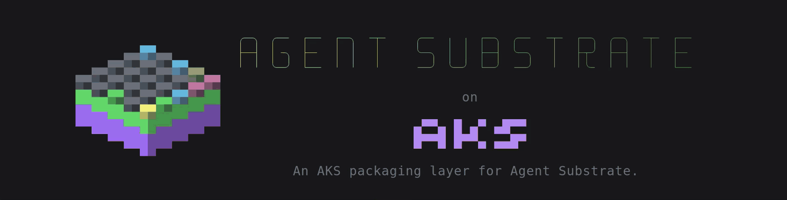
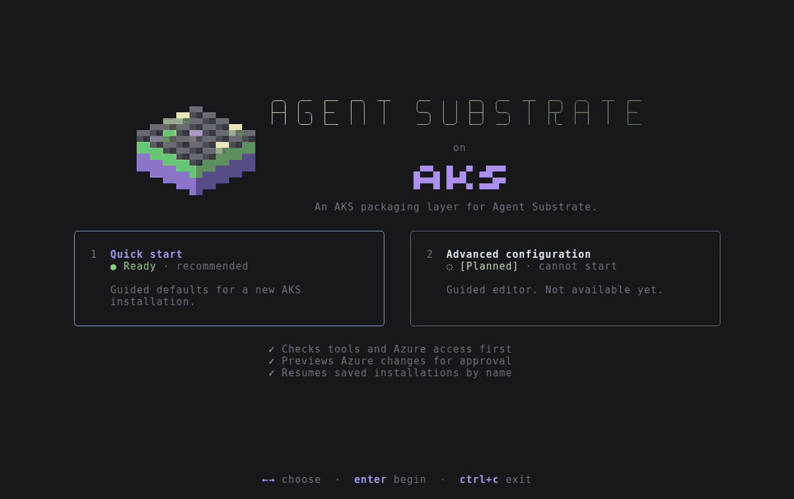

<div align="center">



# Agent Substrate on AKS

**Run [Agent Substrate](https://github.com/agent-substrate/substrate) on Azure Kubernetes Service with one guided command.**

[](#status-and-roadmap)
[](LICENSE)
[](https://github.com/agent-substrate/substrate/releases/tag/v1.0.0)
[](https://learn.microsoft.com/azure/aks/)

[Quickstart](#quickstart) · [How it works](#how-it-works) · [Try the demo](#try-the-demo) ·
[Tear down](#tear-down) · [Documentation](#documentation)

</div>

A guided installer creates a dedicated AKS cluster, container registry, Blob
storage, and identities, then installs Agent Substrate with the
[Azure Blob object-store plugin](https://github.com/agent-substrate-plugins/objectstore-azure-blob)
for snapshot storage.

- **Preview before you pay.** Setup checks your tools, quota, and permissions,
  then shows every billable Azure change and waits for your approval.
- **MicroVM actors on AKS.** Actors run in Kata / Cloud Hypervisor microVMs on a
  dedicated node pool; KVM support is verified before installation.
- **Snapshots in Azure Blob.** Memory, file, and disk state survive suspend and
  resume, stored through workload identity rather than keys.
- **Secure defaults.** Microsoft Entra sign-in with Azure RBAC, local accounts
  disabled, and the Kubernetes API limited to your IP address.
- **One-command teardown.** Everything lives in one resource group that
  `destroy` deletes.

> [!WARNING]
> **Experimental, single-tenant, and billable.** Setup creates a new AKS cluster
> in a dedicated resource group. [Teardown](#tear-down) deletes the entire group
> and all installation data. Do not add unrelated resources to it.

## Quickstart

### 1. Check the prerequisites

You need a Linux or macOS workstation with these tools:

| Tool | Install |
| --- | --- |
| [Go](https://go.dev/dl/) 1.27.3+ | Go 1.21 or later downloads the required version automatically |
| [Git](https://git-scm.com/downloads) | |
| [Azure CLI](https://learn.microsoft.com/cli/azure/install-azure-cli) | Then run `az bicep install` |
| [`kubectl`](https://kubernetes.io/docs/tasks/tools/) and [`kubelogin`](https://azure.github.io/kubelogin/install.html) | Run `az aks install-cli` to install both |

And an Azure subscription with:

| Requirement | Notes |
| --- | --- |
| Permissions | **Owner**, or **Contributor** plus **User Access Administrator** or **Role Based Access Control Administrator**, on the subscription |
| AKS capacity | AKS 1.37, VM quota, and nested virtualization in your region |

Setup checks these before creating anything, and prints an install command or
link for any missing tool. Docker with buildx or Podman is needed only to
[build images from source](docs/configuration.md#image-source).

### 2. Run setup

```sh
git clone https://github.com/Azure/substrate-aks.git
cd substrate-aks
az login
az bicep install
make setup
```

Setup asks for a name and region, shows a review of the installation, and then
works through six stages. Nothing is billed until you confirm, and the registry
and the cluster each wait for you to approve an Azure preview:

<p align="center">
  
  <br>
  <sub>A simulated run with Azure operations stubbed and shortened. Press <code>?</code> in the workspace for keys.</sub>
</p>

`make setup` builds `bin/substrate-aks` and runs `bin/substrate-aks setup`;
pass flags with `ARGS`, for example `make setup ARGS="--accessible"`. Your
choices are saved as a named installation in your user state directory, so
`bin/substrate-aks setup NAME` resumes it after a failure.

<details>
<summary><b>Useful variants</b></summary>

| Command | Use |
| --- | --- |
| `az account set --subscription SUBSCRIPTION_UUID` | Select a different subscription **before** creating an installation |
| `bin/substrate-aks setup NAME` | Resume or reconcile a saved installation |
| `bin/substrate-aks setup --accessible` | Screen-reader-friendly, line-oriented prompts |
| `bin/substrate-aks setup --api-cidr YOUR_PUBLIC_IPV4/32` | Set API access explicitly instead of detecting your IP |
| `bin/substrate-aks setup --yes --with-demo` | Install `substrate-dev` without prompts; accepts billing and selects the kube-context |

Use `NO_COLOR=1` for plain output. See [configuration](docs/configuration.md)
for identity overrides and [operations](docs/operations.md#guided-installation)
for automation options.

</details>

### 3. Connect

**When setup finishes, run the shell exports it prints.** They point `kubectl`
at the new cluster and put `kubectl ate` on your `PATH`. Setup can also add the
cluster to your regular kubeconfig; it asks first, and never edits shell profiles.

> [!TIP]
> **What it costs:** the default cluster has two `Standard_D4s_v6` nodes, about
> $0.40/hour combined at `eastus2` pay-as-you-go rates, plus disks, a Basic
> container registry, and Blob storage. [Tear down](#tear-down) when you are done.

## How it works

Bicep creates the Azure resources, Kustomize components adapt Substrate's
manifests for Azure, and the installer runs the pinned upstream `ate-setup` to
deploy them. See [architecture](docs/architecture.md) for the full picture.

| Component | Default |
| --- | --- |
| AKS | Kubernetes 1.37; one system node and one dedicated microVM node, `Standard_D4s_v6` |
| Operator access | Microsoft Entra sign-in and cluster-scoped Azure RBAC; local accounts disabled |
| Runtime | Kata / Cloud Hypervisor microVMs; KVM is checked before installation |
| Substrate | [`v1.0.0`](https://github.com/agent-substrate/substrate/releases/tag/v1.0.0): API server, controller, networking, and atelet |
| Database | Bundled PostgreSQL with a 32 GiB Azure Disk; no HA or backups |
| Images | Release images imported into a private Azure Container Registry (ACR); the demo and Azure Blob plugin images are built with ko and pushed there |
| Storage | Azure Blob containers for snapshots and runtime assets, served by the Azure Blob object-store plugin |
| Demo | Optional counter microVM workload |

> [!IMPORTANT]
> **This is not a production or multi-tenant deployment.** The AKS API is public
> and IP-restricted by default; Substrate has no public ingress. ACR and Blob
> endpoints are publicly reachable but require authentication. Actor image access
> and Blob permissions are installation-wide, not per actor or tenant. See
> [network and authorization boundaries](docs/configuration.md#network-and-authorization-boundaries).

Setup checks quota and VM availability before billing, but Azure capacity is
not reserved. Check the
[validation status and known limits](docs/operations.md#validation-and-limitations)
before choosing a different region or VM size.

## Try the demo

The counter demo shows an actor keeping its state across suspend and resume.
Each request increments three counters: one in process memory, one in a file on
a durable volume, and one on the root filesystem.

Apply setup's printed shell exports first. If you skipped the optional demo,
deploy it with `bin/substrate-aks demo`. Then create an actor:

```sh
kubectl ate create actor my-counter \
  -a ate-demo-counter-microvm --template counter-microvm
```

In a second terminal, forward local port 8000 to the actor:

```sh
kubectl ate proxy actor my-counter -a ate-demo-counter-microvm
```

Back in the first terminal, increment the counters, suspend the actor, and call
it again. The next request resumes the actor from its snapshot, and every
counter continues where it left off:

```console
$ curl -X POST http://localhost:8000
preserved memory count: 1 | preserved file counter: 1 | preserved rootfs counter: 1

$ kubectl ate suspend actor my-counter -a ate-demo-counter-microvm --mode=sync

$ curl -X POST http://localhost:8000
preserved memory count: 2 | preserved file counter: 2 | preserved rootfs counter: 2
```

`--mode=sync` waits until the snapshot is uploaded to Blob storage. See the
[upstream counter guide](https://github.com/agent-substrate/substrate/tree/v1.0.0/demos/counter)
for more, and [client setup and authentication](docs/operations.md#client-and-counter-demo)
for how `kubectl ate` reaches the cluster.

## Manage your installation

Commands take an installation `NAME`, which is optional when only one is saved.
`destroy` always requires it.

| Command | Purpose |
| --- | --- |
| `bin/substrate-aks list` | List saved installations |
| `bin/substrate-aks init [NAME]` | Save an installation without creating Azure resources |
| `bin/substrate-aks doctor` | Check local tools; no Azure resource calls |
| `bin/substrate-aks plan` | Preview real infrastructure changes using Bicep what-if |
| `bin/substrate-aks status` | Inspect Substrate pods and persistent volume claims |
| `bin/substrate-aks client` | Install the matching `kubectl ate` and print shell exports |
| `bin/substrate-aks setup --verbose` | Show underlying commands and detailed output |

- **Failures keep resources.** Fix the reported error and rerun `setup NAME`;
  there is no automatic rollback. See [retry and teardown](docs/operations.md#retry-and-teardown).
- **Saved settings win.** They take precedence over setup flags and your active
  Azure subscription. Use a new name for a different installation. See
  [saved settings](docs/configuration.md#saved-settings-are-authoritative).
- **Your IP changed?** Update the API allowlist as described in
  [region and API access](docs/configuration.md#region-and-api-access).
- **Keep local state private.** Each installation's directory holds its
  kubeconfig, logs, and the only local record of its billable resources. See
  [local workspace](docs/configuration.md#local-workspace).

## Tear down

Use the exact command printed by setup, or substitute your installation name
and resource group:

```sh
bin/substrate-aks destroy substrate-dev --confirm-delete substrate-dev
```

> [!CAUTION]
> **Deletes the entire owned resource group:** AKS, ACR and its images, database
> data, snapshots, runtime assets, and identities. There is no automatic recovery.
> The command waits for Azure deletion, then removes the installation's local
> directory. The shared Go-installed client stays in place.

If the resource group was deleted outside the installer, clear the deleted image
references before reusing the saved installation:

```sh
bin/substrate-aks images substrate-dev --reset-config
bin/substrate-aks setup substrate-dev
```

Reset is refused while the resource group exists. See
[retry and teardown](docs/operations.md#retry-and-teardown).

## Documentation

| Guide | Contents |
| --- | --- |
| [Architecture](docs/architecture.md) | How Bicep, Kustomize, and the pinned upstream `ate-setup` fit together |
| [Configuration](docs/configuration.md) | Settings, node pools, identities, permissions, networking, and image sources |
| [Operations](docs/operations.md) | Lifecycle commands, the demo, diagnostics, retries, teardown, and validation status |
| [Azure deployment components](deploy/README.md) | Where to change Azure workload settings |

## Status and roadmap

This is an early, experimental release. Each installation creates its own
cluster, and the CLI is the only supported way to install. Planned work:

- **Install without the CLI:** an AKS kustomize Component, kustomization,
  and Helm chart over upstream's release ([#25](https://github.com/Azure/substrate-aks/issues/25)), and reusable Bicep modules
  ([#7](https://github.com/Azure/substrate-aks/issues/7))
- **Existing clusters and resource groups**, not only ones setup creates
- **Sizing:** configurable system node pool ([#23](https://github.com/Azure/substrate-aks/issues/23)) and control plane
  ([#24](https://github.com/Azure/substrate-aks/issues/24)), local NVMe snapshot disks ([#18](https://github.com/Azure/substrate-aks/issues/18)), and a guard against mixed CPU
  generations ([#12](https://github.com/Azure/substrate-aks/issues/12))
- **Managed services:** Azure Database for PostgreSQL ([#2](https://github.com/Azure/substrate-aks/pull/2)) and managed
  Prometheus and Grafana monitoring ([#14](https://github.com/Azure/substrate-aks/pull/14))
- **Benchmarks:** upstream's suite and Azure-recommended tests, run on AKS
  ([#26](https://github.com/Azure/substrate-aks/issues/26))
- **Lifecycle:** choosing from supported Substrate releases ([#17](https://github.com/Azure/substrate-aks/issues/17)), and
  separate uninstall, data retention, and infrastructure destruction ([#10](https://github.com/Azure/substrate-aks/issues/10))
- **Demos:** an account-free installation tour ([#8](https://github.com/Azure/substrate-aks/issues/8)) and a richer
  durability demo ([#9](https://github.com/Azure/substrate-aks/issues/9))

See [open issues](https://github.com/Azure/substrate-aks/issues) for more, and
[validation and limitations](docs/operations.md#validation-and-limitations)
for what has been validated on Azure.

## Related projects

- [Agent Substrate](https://github.com/agent-substrate/substrate): the runtime this repository installs
- [Azure Blob object-store plugin](https://github.com/agent-substrate-plugins/objectstore-azure-blob): snapshot and asset storage on Azure Blob
- [ate.dev](https://ate.dev): Agent Substrate documentation and project site

## Development

```sh
make build verify test-unit   # build, lint, and unit tests
make test                     # adds pinned-source contract tests (needs network)
make bicep                    # compile the infrastructure templates
```

None of these provision Azure resources. See
[development checks](CONTRIBUTING.md#development-checks) for details.

## Contributing

This project welcomes contributions and suggestions. Most contributions require
you to agree to a Contributor License Agreement (CLA) declaring that you have
the right to grant us the rights to use your contribution. For details, visit
[Contributor License Agreements](https://cla.opensource.microsoft.com).

When you submit a pull request, a CLA bot will determine whether you need to
provide a CLA and decorate the PR appropriately. Follow the instructions
provided by the bot. You will only need to do this once across Microsoft
repositories using this CLA.

This project has adopted the
[Microsoft Open Source Code of Conduct](https://opensource.microsoft.com/codeofconduct/).
For more information see the
[Code of Conduct FAQ](https://opensource.microsoft.com/codeofconduct/faq/)
or contact [opencode@microsoft.com](mailto:opencode@microsoft.com).

For security reporting, see [SECURITY.md](SECURITY.md).
For support information, see [SUPPORT.md](SUPPORT.md).

## Trademarks

This project may contain trademarks or logos for projects, products, or
services. Authorized use of Microsoft trademarks or logos is subject to and
must follow
[Microsoft's Trademark & Brand Guidelines](https://www.microsoft.com/legal/intellectualproperty/trademarks/usage/general).
Use of Microsoft trademarks or logos in modified versions of this project must
not cause confusion or imply Microsoft sponsorship. Any use of third-party
trademarks or logos is subject to those third-party's policies.
