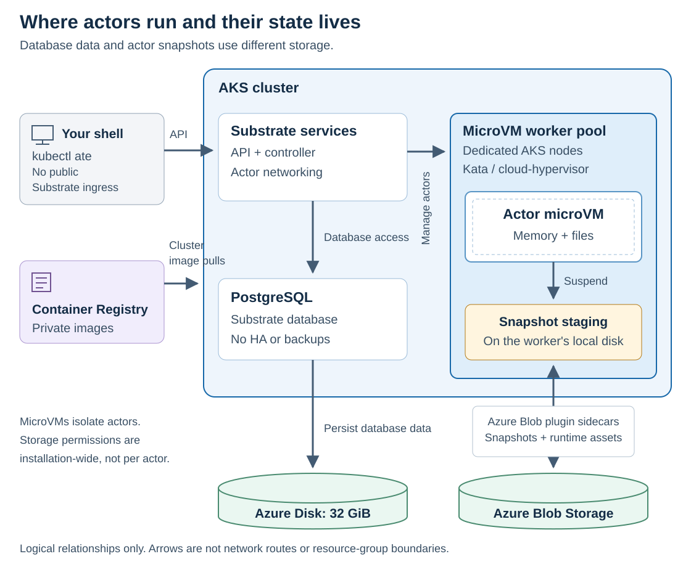

# Substrate on AKS

Run [Agent Substrate](https://github.com/agent-substrate/substrate) on Azure
Kubernetes Service (AKS). The guided installer creates the Azure resources,
imports the Substrate release images, and installs Substrate with the
[Azure Blob object-store plugin](https://github.com/agent-substrate-plugins/objectstore-azure-blob).

Substrate runs workloads called *actors*. The counter demo runs an actor in a
microVM, a lightweight virtual machine, and lets you suspend and resume it.

> [!WARNING]
> **Experimental, single-tenant, and billable.** This quickstart creates a new AKS
> cluster in a dedicated resource group. [Teardown](#tearing-down) deletes the
> entire group and all installation data. Do not add unrelated resources to it.

[Quickstart](#quickstart) · [What gets installed](#what-gets-installed) ·
[Try the demo](#try-the-demo) · [Manage](#manage-your-installation) ·
[Tear down](#tearing-down) · [Documentation](#documentation)

## Quickstart

**Prerequisites**

| Requirement | Notes |
| --- | --- |
| AKS Version | 1.37 or above |
| Linux or macOS | Installer host; cluster workloads use Linux/amd64 |
| Go 1.27.3+ and Git | Go can download the required toolchain automatically |
| Azure CLI | Sign in to the target subscription; install Bicep with `az bicep install` |
| Azure `kubelogin` | Signs `kubectl` in to the cluster with your Azure CLI login |
| Azure permissions | Subscription-scope deployments, resource creation, and role assignments; Contributor alone is insufficient |
| Docker with buildx or Podman | [build images from source](docs/configuration.md#image-source)|

### 2. Clone the repository and sign in

```sh
git clone https://github.com/Azure/substrate-aks.git
cd substrate-aks
```

```sh
az login
```

Check the active subscription before starting setup:

```sh
az account show --query "{name:name, id:id}" --output table
```

To select a different subscription:

```sh
az account set --subscription SUBSCRIPTION_UUID
```

Install Bicep for Azure resource deployments:

```sh
az bicep install
```

### 3. Run guided setup

```sh
make setup
```

`make setup` builds `bin/substrate-aks` and runs `bin/substrate-aks setup`. Pass
setup flags with `ARGS`, for example `make setup ARGS="--accessible"`.

Setup checks your tools and Azure access, asks for a name and region, and
saves your choices as a named installation in your user state directory
(`~/.local/state/substrate-aks` on Linux, `~/Library/Application Support/substrate-aks`
on macOS).
It previews every billable change and waits for your approval before creating
anything. Press `?` in the workspace for keys.

**When setup finishes, run the shell exports it prints.** They point `kubectl`
at the new cluster and put `kubectl ate` on your `PATH`. Setup can also add the
cluster to your regular kubeconfig; it asks first, and never edits shell profiles.

You're now ready to [try the demo](#try-the-demo).

### Setup options

After the first build, run the binary directly to use these options:

| Command | Use |
| --- | --- |
| `bin/substrate-aks setup NAME` | Resume or reconcile a saved installation |
| `bin/substrate-aks setup --accessible` | Screen-reader-friendly, line-oriented prompts |
| `bin/substrate-aks setup --api-cidr YOUR_PUBLIC_IPV4/32` | Set API access explicitly instead of detecting your IP |
| `bin/substrate-aks setup --yes --with-demo` | Install `substrate-dev` without prompts; accepts billing and selects the kube-context |

Use `NO_COLOR=1` for plain output. See [configuration](docs/configuration.md) for
identity overrides and [operations](docs/operations.md#guided-installation) for
automation options.

## What gets installed

Actors run in microVMs on a dedicated AKS worker pool. Their snapshots go to
Blob Storage through the Azure Blob plugin; PostgreSQL uses a separate Azure
Disk for database data. ACR supplies the container images:



The diagram shows logical relationships, not network routes or resource-group
boundaries.

| Component | Default |
| --- | --- |
| AKS | Kubernetes 1.37; one system node and one dedicated microVM node, `Standard_D4s_v6` |
| Operator access | Microsoft Entra sign-in and cluster-scoped Azure RBAC; local accounts disabled |
| Runtime | Kata / cloud-hypervisor microVMs; KVM is checked before installation |
| Substrate | API server, controller, networking, and the atelet node agent |
| Database | Bundled PostgreSQL with a 32 GiB Azure Disk; no HA or backups |
| Substrate version | [`v1.0.0`](https://github.com/agent-substrate/substrate/releases/tag/v1.0.0) |
| Images | Release images imported into a private Azure Container Registry (ACR); the demo and Azure Blob plugin images are built there |
| Storage | Azure Blob containers for snapshots and runtime assets, served by the Azure Blob object-store plugin |
| Demo | Optional counter microVM workload |

> [!IMPORTANT]
> **This is not a production or multi-tenant deployment.** The AKS API is public
> and IP-restricted by default; Substrate has no public ingress. ACR and Blob
> endpoints are publicly reachable but require authentication. Actor image access
> and Blob permissions are installation-wide, not per actor or tenant.

Snapshot inspection is optional and read-only. Snapshots can contain memory,
files, and secrets. Removing the reader from your config does not revoke an
existing grant; remove it in Azure IAM or tear down.

Setup checks quota and VM availability before billing, but Azure capacity is
not reserved. See the
[tested configurations and remaining limits](docs/operations.md#live-acceptance-and-limitations)
before choosing a different region or VM size.

## Try the demo

Apply setup's printed shell exports first. If you skipped the optional demo,
deploy it now:

```sh
bin/substrate-aks demo
```

1. Create a counter actor:

   ```sh
   kubectl ate create actor my-counter \
     -a ate-demo-counter-microvm --template counter-microvm
   ```

1. Inspect the actor:

   ```sh
   kubectl ate get actor my-counter -a ate-demo-counter-microvm
   ```

1. Suspend the actor:

   ```sh
   kubectl ate suspend actor my-counter -a ate-demo-counter-microvm --mode=sync
   ```

1. Resume the actor:

   ```sh
   kubectl ate resume actor my-counter -a ate-demo-counter-microvm
   ```

Follow the [upstream counter guide](https://github.com/agent-substrate/substrate/tree/main/demos/counter)
to call the actor over HTTP and compare its state before and after suspension.
See [client setup and authentication](docs/operations.md#client-and-counter-demo) for details.

## Manage your installation

### Select an installation

Use `bin/substrate-aks list` to find saved installation names. Commands take an
installation `NAME`; most let you omit it when only one installation is saved.
The exceptions are:

- `init` and `setup --yes` use `substrate-dev` when you omit the name.
- Interactive `setup` without a name asks for a new installation name.
- `destroy` always requires an explicit name.

### Run common commands

Add your installation name to target it explicitly, for example
`bin/substrate-aks status substrate-dev`.

| Command | Purpose |
| --- | --- |
| `bin/substrate-aks list` | List saved installations |
| `bin/substrate-aks init [NAME]` | Save an installation without creating Azure resources |
| `bin/substrate-aks doctor` | Check local tools; no Azure resource calls |
| `bin/substrate-aks plan` | Preview real infrastructure changes using Bicep what-if |
| `bin/substrate-aks status` | Inspect Substrate pods and persistent volume claims |
| `bin/substrate-aks client` | Install the matching `kubectl ate` and print shell exports |
| `bin/substrate-aks setup --verbose` | Show underlying commands and detailed output |

### Retry a failed setup

Fix the reported error and rerun `bin/substrate-aks setup NAME`. Resources
and logs remain after a failure; there is no automatic rollback.

### Keep the deployment target unchanged

Saved settings take precedence over setup flags
and your active Azure subscription. Run setup with a new name for a different
installation. Declining the billing confirmation for a new installation
discards it; nothing is left in `list`.
If your public IP changes, `kubectl` loses access to the cluster. Update
`aks.apiAuthorizedCidrs` in the installation's `installation.json` with the new
address, then run:

```sh
bin/substrate-aks plan NAME
```

```sh
bin/substrate-aks provision NAME
```

### Protect local state

Each installation's directory under
`installations/NAME/` in the state directory contains its saved settings,
kubeconfig, logs, and deployment records as well as caches. Set
`SUBSTRATE_AKS_HOME` to use a different location.

| Platform | Default state directory |
| --- | --- |
| Linux | `$XDG_STATE_HOME/substrate-aks`, or `~/.local/state/substrate-aks` if unset |
| macOS | `~/Library/Application Support/substrate-aks` |

Keep this directory private and retain it while the installation exists.
Deleting local state does **not** delete Azure resources. Use
[teardown](#tearing-down) to remove both resources and local state. If local
state is already lost, delete the resource group with
`az group delete --name RESOURCE_GROUP`.

See [operations](docs/operations.md) for individual lifecycle commands and
diagnostics, and [configuration](docs/configuration.md) for settings and permissions.

## Tearing down

Use the exact command printed by setup, or substitute your installation name
and resource group for the two `substrate-dev` values below:

```sh
bin/substrate-aks destroy substrate-dev --confirm-delete substrate-dev
```

> [!CAUTION]
> **Deletes the entire owned resource group:** AKS, ACR and its images, database
> data, snapshots, runtime assets, and identities. There is no automatic recovery.
> The command waits for Azure deletion, then removes the installation's local
> directory. The shared Go-installed client stays in place.

If the resource group was deleted outside the installer, clear the deleted image
references before reusing the saved installation:

```sh
bin/substrate-aks images substrate-dev --reset-config
bin/substrate-aks setup substrate-dev
```

Reset is refused while the resource group exists. See
[retry and teardown](docs/operations.md#retry-and-teardown).

## Documentation

| Guide | Contents |
| --- | --- |
| [Installation architecture](docs/architecture.md) | How Bicep, Kustomize, and the pinned upstream `ate-setup` fit together; no standalone Helm or GitOps install yet |
| [Configuration](docs/configuration.md) | Config fields, identities, permissions, networking, and image/source settings |
| [Operations](docs/operations.md) | Lifecycle commands, client setup, diagnostics, retries, teardown, and validation limits |
| [Azure deployment components](deploy/README.md) | Where to change Azure workload settings |

## Development

```sh
make test
make verify
make build
make bicep
```

These checks do not provision Azure resources. `make test` includes
pinned-source integration contracts and downloads source and Go modules;
use `make test-unit` for unit tests only. See
[development checks](docs/operations.md#development-checks) for details.

## Contributing

This project welcomes contributions and suggestions. Most contributions require
you to agree to a Contributor License Agreement (CLA) declaring that you have
the right to grant us the rights to use your contribution. For details, visit
[Contributor License Agreements](https://cla.opensource.microsoft.com).

When you submit a pull request, a CLA bot will determine whether you need to
provide a CLA and decorate the PR appropriately. Follow the instructions
provided by the bot. You will only need to do this once across Microsoft
repositories using this CLA.

This project has adopted the
[Microsoft Open Source Code of Conduct](https://opensource.microsoft.com/codeofconduct/).
For more information see the
[Code of Conduct FAQ](https://opensource.microsoft.com/codeofconduct/faq/)
or contact [opencode@microsoft.com](mailto:opencode@microsoft.com).

For security reporting, see [SECURITY.md](SECURITY.md).
For support information, see [SUPPORT.md](SUPPORT.md).

## Trademarks

This project may contain trademarks or logos for projects, products, or
services. Authorized use of Microsoft trademarks or logos is subject to and
must follow
[Microsoft's Trademark & Brand Guidelines](https://www.microsoft.com/legal/intellectualproperty/trademarks/usage/general).
Use of Microsoft trademarks or logos in modified versions of this project must
not cause confusion or imply Microsoft sponsorship. Any use of third-party
trademarks or logos is subject to those third-party's policies.
