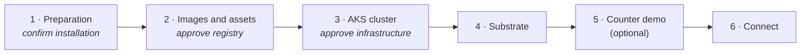
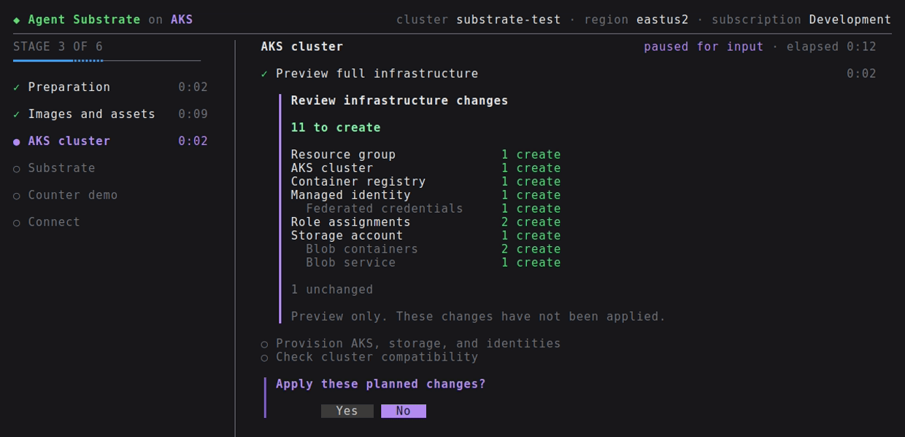

# Operations

[Quickstart](../README.md) | [Architecture](architecture.md) | [Configuration](configuration.md)

Run commands from the repository root. Each command takes an installation
`NAME` (as an argument or `--name`); it is optional when only one installation
is saved, except for `init`, `setup` and `destroy`. Without a name, `init` and
`setup --yes` create `substrate-dev`, interactive `setup` asks for a name, and
`destroy` refuses to run. Run `bin/substrate-aks list` to see saved
installations. Settings are stored in a per-user state directory; see
[configuration](configuration.md#create-a-configuration).

- [Guided installation](#guided-installation)
- [Registry and image bootstrap](#registry-and-image-bootstrap)
- [Provision and install](#provision-and-install)
- [Component redeployment](#component-redeployment)
- [Client and counter demo](#client-and-counter-demo)
- [Private actor images](#private-actor-images)
- [Progress and diagnostics](#progress-and-diagnostics)
- [Retry and teardown](#retry-and-teardown)
- [Validation and limitations](#validation-and-limitations)

## Guided installation

Install the [prerequisites](../README.md#quickstart), then run:

```sh
az login
make setup
```

`make setup` builds `bin/substrate-aks` and runs its `setup` command. Pass setup
flags with `ARGS`, for example `make setup ARGS="--accessible"`.

Plain `setup` creates a new installation and asks for its name; names that are
already saved are rejected. `setup NAME` resumes or reconciles that saved
installation.

### What setup does

Setup works through a fixed sequence of stages. The left rail shows where you
are; the main pane lists each stage's operations as they run.



Stages with an approval in italics pause for you before anything is billed.

| Stage | What happens |
| --- | --- |
| Preparation | Checks local tools, discovers your Azure identity, detects your public IP, and loads regions. A new installation then asks for a name, region, AKS API access when your public IP was detected, and optional snapshot access. Read-only Azure checks confirm AKS version and VM availability, CPU quota, and discoverable permissions. You review the installation before anything is billed. Docker or Podman is checked only when an existing installation uses `imageSource: source` and its images aren't built yet; new installations import release images and skip the check. |
| Images and assets | Previews and creates the private registry, then imports the release images (or builds them with `imageSource: source`), builds the counter demo and plugin images, and publishes runtime assets. Skipped when the config already has published images; they are only verified. |
| AKS cluster | Previews and provisions AKS, storage, and identities, then checks the cluster. |
| Substrate | Renders the Azure settings and installs Substrate. |
| Counter demo | Optional; deploys the counter microVM demo. |
| Connect | Installs the matching `kubectl ate` and offers to select the new kube-context. |

Each billable step shows an Azure preview first and waits for your approval.
The registry and the full infrastructure are approved separately.

<p align="center">
  
  <br>
  <sub>An infrastructure preview awaiting approval (simulated; real previews list more identities and role assignments).</sub>
</p>

Previews
summarize changes by resource type; press `d` for full resource IDs. When a
preview deletes resources or contains unknown changes, scroll to the end and
press `a` to acknowledge it before approving. Use standalone `plan` for previews
too large to show inline.

The preflight checks are a snapshot, not a reservation: capacity, policy, and
later Azure validation can still fail.

### Using the workspace

In a terminal, setup runs as a full-screen workspace. Timers count setup work
only and pause while a question or approval waits for you. While an operation
runs, the latest lines of its diagnostic log appear beneath the checklist.

| Key | Action |
| --- | --- |
| `l` | Open the full, scrollable diagnostic log for the current command |
| `d` | Show the installation review or full resource-change IDs |
| `PgUp` / `PgDn` | Scroll a review or the log |
| `Esc` | Close details or logs; never skips an approval |
| `a` | Acknowledge a destructive or unknown preview after reading it |
| `?` | Show help |
| `Ctrl-C` | Stop local work after confirming (press twice to stop now); Azure resources are retained |

Letter shortcuts pause while you type a name or filter regions. In the region
list, press `/` to filter, then Enter to select. Tab and Shift+Tab move between
fields.

The welcome screen offers **Quick start**. **Advanced configuration** is a
planned guided editor and cannot start an installation yet. For custom settings,
run `init NAME`, edit the saved `installation.json` it reports, then run
`setup NAME`.

On narrow terminals the rail is hidden. Below 40 columns or 14 rows, setup shows
compact status and waits for a larger window before accepting input; work in
progress continues.

When setup finishes, it restores your terminal and prints one block of shell
exports. On failure it prints recovery commands instead.

### Options and automation

| Option | Use |
| --- | --- |
| `--accessible` | Line-oriented prompts for screen readers; also used automatically for redirected output and `TERM=dumb` |
| `NO_COLOR=1` | Disable color |
| `--yes` | Accept billing and select the new kube-context without prompts |
| `--with-demo` | Include the counter demo without prompts |
| `--skip-context-handoff` | Leave your kubeconfig untouched and print exports for the private kubeconfig |
| `--container-engine=auto\|docker\|podman` | Choose an image builder for [source builds](configuration.md#image-source); `auto` offers a choice when both work |

For automation, pass a name and flags instead of piping answers into prompts.
`--yes` uses `substrate-dev` when no name is given:

```sh
bin/substrate-aks setup substrate-dev --yes --with-demo
```

**Run the final shell exports printed by setup.** The installer cannot change
your shell's `PATH` or `KUBECONFIG`, and never edits shell profiles. CI runs that
only need the installation's private kubeconfig can skip the context handoff:

```sh
bin/substrate-aks setup substrate-dev --yes --skip-context-handoff
```

### macOS host setup

Native builds and race tests need Apple's developer tools. If they are not
already installed, run `xcode-select --install`.

Runtime assets are assembled by the pinned `ate-setup` in Go and need no other
tools.

[Source builds](configuration.md#image-source) need Docker Desktop or Podman's
machine running. Apple Silicon also needs working Linux/amd64 builds, including
execution of the pinned Rust build. An engine responding to `info` does not prove
that cross-architecture builds work.

Go's `-bind_at_load` deprecation warning and Azure CLI's Python invalid-escape
warnings have been reported. A warning alone does not mean installation failed;
check the command's exit status and error output.
The [Go linker warning](https://github.com/golang/go/issues/63154) comes from
upstream tooling, not installer linker flags.

<details>
<summary><b>Reporting a macOS failure</b></summary>

Capture the failing command, its exit status, and these diagnostics
**from the affected checkout**:

```sh
sw_vers
go version
go env GOVERSION GOTOOLDIR GOHOSTOS GOHOSTARCH CC CGO_ENABLED GOTOOLCHAIN
xcode-select -p
xcrun clang --version
az version
```

</details>

With `GOTOOLCHAIN=auto`, Go can select a newer toolchain for this module.
Native macOS assembly, publication, and installation remain unvalidated;
Darwin cross-builds are not a substitute.

## Registry and image bootstrap

Setup handles these steps for you. To run them individually:

```sh
bin/substrate-aks doctor
bin/substrate-aks plan --registry-only
bin/substrate-aks provision --registry-only
bin/substrate-aks images
```

`doctor` checks local tools without calling Azure. Add an installation `NAME` to
also check supplied runtime assets, and `--azure` for
read-only checks of VM availability, quota, and permissions in the configured
region. `plan` runs a Bicep what-if and deploys nothing.

> [!WARNING]
> Registry provisioning starts billing. It creates the dedicated resource group,
> a Basic ACR, and `AcrPush` and `Container Registry Data Importer and Data Reader`
> grants for the upload identity. It does not create AKS or Blob storage yet.

**Release images.** By default, `images` checks that every image upstream
published for the pinned release is labelled as built from the pinned commit,
then imports each one into ACR by digest with `az acr import`. It builds the
counter demo image, which releases do not publish, and the Azure Blob plugin
image with ko. Neither needs Docker or Podman. Importing uses the upload
identity's `Container Registry Data Importer and Data Reader` grant. It writes
images only through import, as `AcrPush` already allows, and cannot change the
registry's settings. It assembles runtime assets with the pinned `ate-setup`
unless `assetsDir` is set, in which case it verifies the supplied files without
overwriting them. Image settings are saved only after the imports, builds, and
checksum checks succeed.

**Source builds.** With `"imageSource": "source"`, `images` builds the release
images from the pinned commit instead, with Docker buildx or Podman (rootless
works on Linux). Setup then checks the builder before any Azure calls and offers
a choice when both work; `--yes` prefers Docker. Checking Docker starts the
buildx builder, which may download a BuildKit container and has two minutes to
start. If it is unhealthy, automatic mode falls back to Podman; an explicit
`--container-engine` never falls back. Reusing configured images needs no builder.

ACR authentication uses your Azure login. Registry credentials stay in the
private workspace; your Docker credentials, context, and buildx settings are left
alone. If the CLI reports a workspace context-store conflict, move the old store
aside as instructed.

To check that saved images are still accessible:

```sh
bin/substrate-aks images --check
```

`setup` and `install` also run this check. Authentication and network failures
are reported separately from missing images; the check never rebuilds images
or changes your config.

A failed import or build can leave images in ACR without updating the config;
fix the error and retry. New role grants can take a few minutes to propagate. The
uploader must be the configured upload identity or a member of the configured
publisher group.

Deployment commands refresh credentials for the owned ACR, so expired tokens
never require a rebuild. Other registries use your existing credentials.

## Provision and install

After image publication:

```sh
bin/substrate-aks plan
bin/substrate-aks provision
bin/substrate-aks check
bin/substrate-aks prepare
bin/substrate-aks install
bin/substrate-aks status
bin/substrate-aks client
```

| Command | Result |
| --- | --- |
| `provision` | Create AKS, Blob containers, identities, and permissions; reuse the ACR |
| `check` | Verify node versions, microVM worker count, and required certificate APIs |
| `prepare` | Render Azure settings into the managed upstream source checkout |
| `install` | Verify images and KVM, upload runtime assets, and deploy Substrate |
| `status` | Show pods and persistent volume claims |
| `client` | Install the matching `kubectl ate` and print shell exports |

The cluster uses Azure CNI Overlay and Cilium network policy, with a separate
tainted microVM node pool. Automatic Kubernetes version upgrades are disabled to
preserve the supported 1.37 target. Node OS updates use AKS's `NodeImage` channel
with AKS-managed timing: patched images include security and bug fixes without
changing the Kubernetes version. See [configuration](configuration.md) for
identity and access settings.

> [!NOTE]
> Node image updates can drain and reimage nodes, interrupting workloads,
> especially with the default single microVM worker. Actor recovery through this
> maintenance has not been validated, and it is not a zero-downtime or
> cross-node memory guarantee. Configure an AKS maintenance window for
> controlled timing, and recheck KVM readiness and actors afterward. See
> [AKS node OS update channels](https://learn.microsoft.com/azure/aks/auto-upgrade-node-os-image).
> Existing clusters pick up this setting only when infrastructure is provisioned
> again.

Installation runs a temporary privileged probe that opens `/dev/kvm`, creates
a test VM, and checks the native ACR credential provider. This needs cluster
administrator access. The probe is removed afterward; unsupported nodes cause
an error, not a fallback to another runtime.

AKS Ubuntu nodes must provide these files:

```text
/var/lib/kubelet/credential-provider/acr-credential-provider
/etc/kubernetes/azure.json
```

Discovering the certificate APIs is not enough: the signer and consuming
workloads must also roll out successfully. Runtime assets are private Blob
objects, verified by checksum when fetched.

## Component redeployment

```sh
bin/substrate-aks install --component atelet
bin/substrate-aks install --component apiserver
```

Use the CLI for component redeploys. They require a completed installation or
a retry of the same interrupted component operation. Full redeploys retain
upstream's active-worker safeguards.

Do not edit managed source checkouts or change fingerprints to force a redeploy.
**Upgrades are not implemented:** changing the source or image set requires a
fresh installation or a separately reviewed upgrade plan.

## Client and counter demo

Run `bin/substrate-aks client` and apply its printed exports before using
`kubectl`. Without the kubeconfig export, an unconfigured client may try localhost.

| Setting | Behavior |
| --- | --- |
| Client version | Built from the configured upstream revision |
| Binary location | `GOBIN`, or the first `GOPATH` entry's `bin`; normally `~/go/bin` |
| Kubeconfig | Private installation file unless you accept the context handoff |
| Sharing | Another installation can replace the client; teardown leaves it installed |

Keep Azure CLI and `kubelogin` on PATH and stay signed in to the cluster's
tenant. If refreshing credentials fails, the previous kubeconfig is kept.

`check` asks Kubernetes whether you may create CRDs, waiting up to five minutes
for a new grant to take effect. It confirms authorization only, not that
workloads are healthy.

### Optional kube-context handoff

Setup offers to import and select the installation in a single `KUBECONFIG`
file, or `~/.kube/config`. The interactive default is **No**; `--yes` accepts.
Use `--context-file PATH` to choose another file. Multi-file `KUBECONFIG` needs
an explicit destination unless handoff is skipped.

`--skip-context-handoff` skips the import, even with `--yes`. Setup still
installs the client and prints exports for the private kubeconfig, without
reading yours. It cannot be combined with `--context-file`.

Imports keep unrelated entries but not YAML comments or formatting. They refuse
conflicting names, malformed files, symlinks, and relative credential paths, and
never overwrite an existing entry: on a name conflict, choose another
`--context-file` or resolve the conflict yourself. Imports take kubectl's
`<destination>.lock` and never remove an existing lock. The private installation
kubeconfig is never changed.

To do this later:

```sh
bin/substrate-aks client --use-context
# Or choose a destination:
bin/substrate-aks client --use-context --context-file ~/.kube/substrate
```

Setup prints one set of shell exports after the context choice. Apply those
exports to connect. If handoff is unavailable or fails, setup warns and completes
with exports for the private kubeconfig, including with `--yes`. Cancellation
still stops setup. An explicit `client --use-context` command returns an error if
importing fails; retry it with a suitable destination.

### Try the counter

```sh
# Skip this if setup already installed the demo.
bin/substrate-aks demo
kubectl ate create actor my-counter \
  -a ate-demo-counter-microvm --template counter-microvm
kubectl ate get actor my-counter -a ate-demo-counter-microvm
kubectl ate suspend actor my-counter -a ate-demo-counter-microvm --mode=sync
kubectl ate resume actor my-counter -a ate-demo-counter-microvm
```

For HTTP access, proxy the actor in another terminal and call it:

```sh
kubectl ate proxy actor my-counter -a ate-demo-counter-microvm
curl -X POST http://localhost:8000
```

The proxy reaches the actor through `atenet-router` with a pod certificate for
the `ate-system/atenet-client` ServiceAccount, which the installer allows; anyone
who can request that certificate, such as a cluster admin, can reach every
actor. Follow the [upstream counter guide](https://github.com/agent-substrate/substrate/tree/v1.0.0/demos/counter)
to compare the actor's state before and after suspension.

`kubectl ate` talks directly to Substrate and can port-forward its API.
Without an explicit token, it uses the shared `ate-client` service account.
This is not personal Entra-backed actor authorization.

## Private actor images

Sign in with `az acr login`, push images to the installation's ACR, and reference
them in ActorTemplates, preferably by digest.

Kubernetes and atelet use the node's registry-scoped `AcrPull` access.
Blob sidecars use separate identities. Pull access is installation-wide, not
per actor or tenant. Other private registry providers are not configured.

**Teardown deletes the owned registry and every image pushed there.**
Long-duration credential refresh remains a validation gap.

## Progress and diagnostics

| Output | Location |
| --- | --- |
| Progress and prompts | stderr; plain line updates when redirected |
| Results, previews, and setup's final commands | stdout |
| Detailed command logs | Private files in the installation's `logs/` directory. Before a new installation is saved, Preparation logs to `logs/` in the installer's home directory. |
| `--verbose` | Underlying commands and build output, in standalone commands and accessible setup |

Each command writes its full log to disk, including commands, output, and step
markers; output marked sensitive is never logged. In the workspace, `l` shows a
sanitized tail of the current log so subprocess output never overwrites a form
or approval. For an append-only transcript, use `setup --accessible --verbose`.

Failures show a short error and the log path. If the optional kube-context
handoff fails, setup still completes, warns, and prints exports for the private
kubeconfig.

```sh
bin/substrate-aks provision --registry-only --verbose
bin/substrate-aks status --verbose
```

The `plan` table marks creates, deletes, and modifications with symbols as well
as color, so it stays readable with `NO_COLOR`. Unchanged resources are omitted;
property-level details are in the logs and verbose output.

## Retry and teardown

**Failures retain resources.** Interactive setup offers to retry the failed
command. `--yes` and cancellation do not enter a retry loop. Follow the printed
stage-retry command, or rerun `setup NAME`.

A new setup process checks the installation from the beginning; it does not
resume an arbitrary interrupted stage. Keep the installation ID and target
settings unchanged. Never delete the installation's directory while its
resources still exist.

Ctrl-C, SIGTERM, and terminal hangups (SIGHUP) cancel local command process
groups and allow cleanup. The interactive workspace restores the terminal after
its owned subprocesses exit. A second termination signal exits immediately and
may leave temporary probes to remove manually. Interruption does not undo Azure's
server-side deployment; already-submitted deployments may continue, and resources
remain for retry or teardown.

To delete the installation:

```sh
bin/substrate-aks destroy substrate-dev --confirm-delete substrate-dev
```

> [!CAUTION]
> Deletes the entire owned resource group: AKS, ACR and all its images,
> PostgreSQL data, snapshots, runtime assets, identities, and any unrelated
> resources added to the group. There is no automatic recovery.

The CLI checks the ownership tag and waits for Azure deletion. It does not adopt
or delete a group without the matching tag. An already-absent group is a safe
no-op. After Azure deletion succeeds, `destroy` removes the installation's local
directory, including its settings and logs. Subscription deployment history and
the shared client remain. If `destroy` fails, local state is kept for a retry.

If the resource group was deleted outside the installer, clear references to
deleted images before reusing the saved installation:

```sh
bin/substrate-aks images substrate-dev --reset-config
bin/substrate-aks setup substrate-dev
```

Reset requires Azure to confirm that the target group is absent and no other
group carries the installation tag. It clears only image settings, not the
installation identity, source pin, assets, local records, or Azure resources.

If stale config has already recreated an empty registry or cluster, destroy it
before resetting. Do not remove install records to force a rebuild.
Alternatively, restore the exact configured images and retry, or use a fresh
config after teardown.

## Validation and limitations

The installer has been run end to end many times on real Azure subscriptions,
in multiple regions, with several VM sizes and multi-node microVM pools:

- Guided and non-interactive installs: release image import and source builds
  with Docker or Podman, infrastructure, Substrate, the demo, the client, and
  kube-context import
- Managed Entra sign-in with Azure RBAC and local accounts disabled
- Actor suspend and resume preserving memory, file, and root filesystem state,
  including cold restore from Blob storage onto a new node
- Multi-hour runs of upstream Substrate benchmark workloads
- Component reinstalls, image and cluster checks, and ownership-checked teardown

Recent runs recorded in pull requests:

| Run | Region | Nodes | Covered |
| --- | --- | --- | --- |
| Current pins, from [#22](https://github.com/Azure/substrate-aks/pull/22) | `eastus2` | Default: 1 system and 1 microVM, `Standard_D4s_v6` | `setup --yes --with-demo`, counter suspend and resume, `destroy` |
| Substrate v1.0.0, [#16](https://github.com/Azure/substrate-aks/pull/16) | `westus3` | 1 microVM, `Standard_D8ds_v7` | Release image import, install, demo, suspend and resume with Blob snapshots, `destroy` |
| Substrate v1.0.0-rc.3, [#16](https://github.com/Azure/substrate-aks/pull/16) | `westus3` | 2 microVM, `Standard_D8s_v7` | Install and demo; resume from Blob after the node-local snapshot was deleted |
| Substrate v1.0.0-rc.3, [#16](https://github.com/Azure/substrate-aks/pull/16) | | 1 microVM, `Standard_D8ds_v7`, `Ephemeral` 400 GB OS disk | Snapshots on local NVMe, suspend and resume |
| Earlier pin, [#1](https://github.com/Azure/substrate-aks/pull/1) | `southcentralus`, `eastus2` | `Standard_D4s_v3` | Guided workspace, managed Entra, Podman builds, cold restore on a new node |

There is no CI yet: contributors run the unit, pseudo-terminal, and
pinned-source contract tests and compile the Bicep templates before each change
(see [development checks](../CONTRIBUTING.md#development-checks)), and live
installs are run by hand. [#27](https://github.com/Azure/substrate-aks/issues/27) tracks automating both.

### Memory restore needs matching CPUs

**The same VM size can run on different CPU models.** Cloud Hypervisor refuses
to restore a memory snapshot onto a CPU with a different TSC rate
(`SetTscKhz` fails); the actor's file and disk state survive, but its memory
resets. Older series such as Dsv3 span several CPU generations, so new
installations default to `Standard_D4s_v6`, which runs on one. Keep that series,
or another x86 D/E/F `_v6` or `_v7` size, when you run more than one microVM
node; see [#12](https://github.com/Azure/substrate-aks/issues/12). AKS cannot
change an existing pool's VM size, so destroy and recreate installations created
with the earlier Dsv3 default.

### Not yet validated

- Automatic node image upgrades, and actor recovery through them
- Credential renewal over days or weeks
- Several operators sharing one installation
- Native macOS installation hosts
- Arm64 nodes

Not part of this quickstart: installing into an existing cluster, managed
PostgreSQL ([#2](https://github.com/Azure/substrate-aks/pull/2)), upgrades, autoscaling, dashboards ([#14](https://github.com/Azure/substrate-aks/pull/14)), and shared
filesystems.
